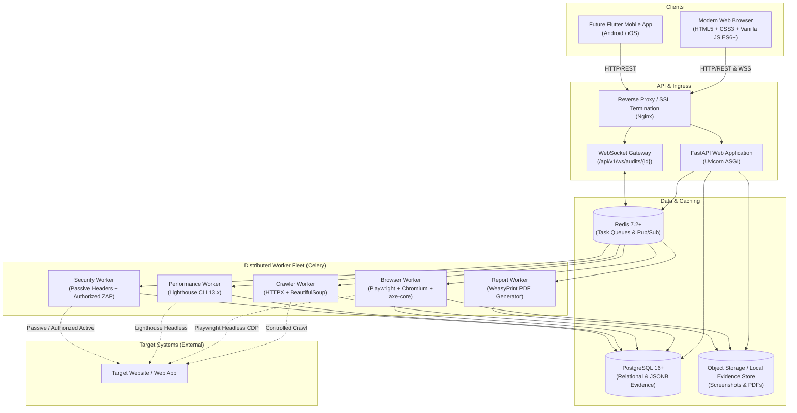
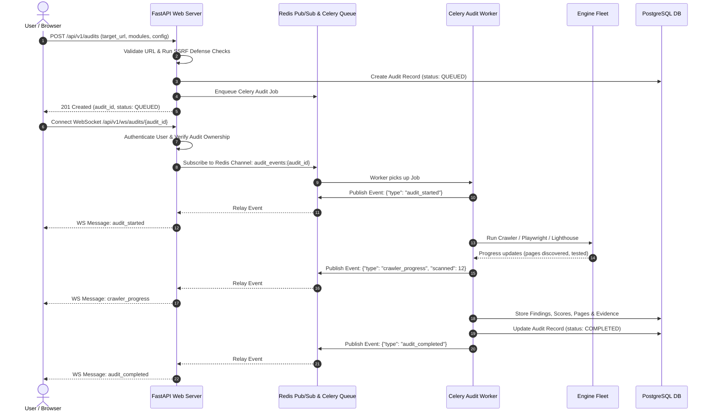

# WebAudit 360 — System Architecture Specification

**Product Name:** WebAudit 360  
**Created By:** Harsh Patel  
**Architectural Version:** 1.0.0  
**Date:** October 30, 2026  

---

## 1. High-Level Architectural Overview

WebAudit 360 is engineered as a multi-tier, asynchronous website intelligence and continuous monitoring platform. It adopts a **Modular Monolith** architecture for the API and core business domain, coupled with an **Asynchronous Distributed Worker Subsystem** for browser automation, network crawling, security testing, and report generation.



---

## 2. Layered Backend Organization

The Python backend is organized into strictly separated layers adhering to Domain-Driven Design (DDD) principles:

```
backend/
├── app/
│   ├── api/
│   │   └── v1/
│   │       ├── endpoints/
│   │       │   ├── auth.py             # User registration, login, token refresh, logout
│   │       │   ├── users.py            # User profile, password updates, account deletion
│   │       │   ├── projects.py         # Project management, domain associations
│   │       │   ├── authorizations.py   # Domain ownership verification (DNS TXT/file)
│   │       │   ├── audits.py           # Audit submission, listing, retrieval, cancellation
│   │       │   ├── pages.py            # Discovered pages, crawl tree, page details
│   │       │   ├── findings.py         # Findings query, filtering, status lifecycle, retest
│   │       │   ├── reports.py          # PDF/JSON report generation and secure downloads
│   │       │   ├── comparisons.py      # Multi-audit and competitor passive comparisons
│   │       │   ├── monitoring.py       # Recurring audit schedules and alert thresholds
│   │       │   ├── visual.py           # Visual regression baselines and diff comparisons
│   │       │   ├── api_health.py       # Authorized API endpoint monitoring
│   │       │   ├── dependencies.py     # Third-party inventory and changes
│   │       │   ├── domain_health.py    # DNS records, SSL/TLS certificate health
│   │       │   ├── team.py             # Team roles (Owner, Admin, Dev, Viewer)
│   │       │   ├── integrations.py     # GitHub issues, webhooks, API keys
│   │       │   └── websockets.py       # Live scan progress event streaming
│   │       └── router.py               # Aggregated v1 API routing
│   ├── core/
│   │   ├── config.py                   # Pydantic Settings (.env configuration)
│   │   ├── security.py                 # Argon2/Bcrypt hashing, JWT generation/validation
│   │   ├── ssrf.py                     # Strict SSRF validation, DNS pinning, IP filters
│   │   ├── database.py                 # SQLAlchemy 2 async engine & sessionmaker
│   │   ├── redis.py                    # Redis client pool & pub/sub connection
│   │   └── logging.py                  # Structured JSON logging with trace correlation IDs
│   ├── models/                         # SQLAlchemy 2 Declarative ORM entities
│   ├── schemas/                        # Pydantic v2 validation and response models
│   ├── repositories/                   # Database CRUD abstraction layer
│   ├── services/                       # Business logic, orchestration, and authorization
│   ├── engines/                        # Specialized auditing modules (BaseAuditEngine)
│   │   ├── base.py                     # BaseAuditEngine abstract contract
│   │   ├── crawler/                    # Single-page & full-site crawler
│   │   ├── performance/                # Lighthouse CLI wrapper & metrics parser
│   │   ├── seo/                        # Headings, canonical, robots, sitemap, meta
│   │   ├── accessibility/              # axe-core Playwright evaluation
│   │   ├── security/                   # Passive headers, TLS, cookies & authorized ZAP
│   │   ├── responsive/                 # Multi-viewport emulation & overflow checks
│   │   ├── technical/                  # Broken links, console errors, HTTP status
│   │   ├── technology/                 # Evidence-based technology detection
│   │   ├── visual/                     # Screenshot capture & pixel diffing
│   │   ├── api_health/                 # Endpoint availability & schema verification
│   │   ├── third_party/                # External scripts, styles, fonts inventory
│   │   └── domain/                     # DNS records, SSL validity, WHOIS heuristics
│   ├── scoring/                        # Transparent, versioned scoring calculation
│   ├── workers/                        # Celery task definitions and lifecycle handlers
│   ├── reports/                        # Jinja2 templates and WeasyPrint PDF compiler
│   └── utils/                          # URL normalization, robots parser, date helpers
```

---

## 3. Auditing Engine Contract (`BaseAuditEngine`)

Every auditing engine inherits from an asynchronous abstract base class to guarantee strict type safety, predictable execution boundaries, error isolation, and traceable evidence collection:

```python
class BaseAuditEngine(ABC):
    engine_name: str
    engine_version: str
    category: AuditCategory

    @abstractmethod
    async def execute(
        self,
        target_url: str,
        config: AuditJobConfig,
        context: ExecutionContext
    ) -> EngineResult:
        """
        Executes the audit against the validated target URL.
        Must return structured EngineResult with:
          - status: SUCCESS, PARTIAL, FAILED, SKIPPED, BLOCKED
          - score: Optional[float] (0.0 to 100.0) or None (N/A)
          - findings: List[FindingCreate]
          - raw_evidence: Dict[str, Any]
          - limitations: List[str]
          - execution_time_ms: int
        """
        pass
```

### Engine Isolation & Error Boundaries
If an individual engine encounters a network timeout, transient browser crash, or unsupported feature:
1. The engine catches the exception and logs it with the associated `audit_id`.
2. The engine returns an explicit `EngineResult(status=AuditStatus.FAILED, error="...", limitations=[...])`.
3. The parent orchestrator marks the module as `FAILED` or `PARTIAL`, allowing all remaining modules to finish cleanly without data corruption.

---

## 4. Crawling & URL Discovery Subsystem

The `CrawlerEngine` operates in two explicit modes:
1. **Single-Page Audit Mode:** Scans only the exact submitted URL. No outbound links are crawled. Network assets (scripts, stylesheets, images) referenced by the page are inspected only for the requested modules.
2. **Full-Website Audit Mode:**
   - **Seed Discovery:** Fetches `robots.txt`, identifies `Sitemap:` directives, downloads and parses `sitemap.xml` for canonical URLs.
   - **Controlled Link Traversal:** Parses HTML `<a href="...">` internal links using `BeautifulSoup4` with `lxml`.
   - **URL Normalization:** Resolves relative paths to absolute URLs, strips tracking query parameters (`utm_*`, `fbclid`, session IDs), lowercases hostnames, removes fragment identifiers (`#...`), and normalizes trailing slashes.
   - **Scope Boundaries:** Strictly confines link discovery to the authorized host and allowed path subtrees. Subdomains are crawled only if explicitly enabled in the project scope.
   - **Crawl Limits & Backpressure:** Enforces safe defaults (max 100 pages, max depth 5, per-host concurrency 2, 1-second politeness delay, 20s HTTP timeout, 10MB response limit).
   - **Orphan Page Heuristics:** Cross-references URLs discovered exclusively in `sitemap.xml` that have zero incoming internal links from the crawled link graph, flagging them as potential orphan pages.

---

## 5. Scoring Algorithm Specification

WebAudit 360 uses a transparent, versioned scoring algorithm (`scoring_version: "1.0.0"`).

### 5.1 Category Weights (When all categories are present):
* **Performance:** 25% (0.25)
* **SEO:** 20% (0.20)
* **Accessibility:** 20% (0.20)
* **Security:** 25% (0.25)
* **Best Practices & Technical Health:** 10% (0.10)

$$\text{Overall Score} = (0.25 \times \text{Perf}) + (0.20 \times \text{SEO}) + (0.20 \times \text{A11y}) + (0.25 \times \text{Sec}) + (0.10 \times \text{Tech})$$

### 5.2 Dynamic Normalization for Incomplete Audits:
If a user selects only a subset of modules (e.g., Performance + SEO), or if a category is unavailable:
1. The missing category is displayed as **N/A** (never 0, never 100).
2. The overall score is calculated by normalizing the weights of only the available categories:
   $$\text{Normalized Score} = \frac{\sum (W_i \times S_i)}{\sum W_i}$$
3. The report explicitly states: *"Score normalized across 2 of 5 categories; Security, Accessibility, and Best Practices excluded from measurement."*

### 5.3 WebAudit 360 Score Classification Labels:
* **90 – 100:** Excellent
* **75 – 89:** Good
* **50 – 74:** Needs Improvement
* **25 – 49:** Poor
* **0 – 24:** Critical

### 5.4 Critical Vulnerability Override:
A website with a confirmed Critical security finding (e.g., verified SQLi or exposed private credential) will display a prominent **Critical Security Alert** badge regardless of high performance or SEO marks.

---

## 6. Real-Time Scan Lifecycle & WebSocket Architecture



---

## 7. Database Entity-Relationship Architecture

Key PostgreSQL relational entities:
* `users`: Primary account record, hashed credentials, role, status.
* `teams`: Organization workspaces for team collaboration.
* `team_members`: Associative table linking users to teams with granular roles (`owner`, `admin`, `developer`, `viewer`).
* `projects`: Grouping of target domains, audit configurations, and settings.
* `domain_authorizations`: Verification challenge state (token, method: DNS_TXT / HTTP_FILE, verified_at, expires_at, authorized_by).
* `audits`: Scan runs (target_url, mode: SINGLE/FULL, device: MOBILE/DESKTOP/BOTH, status, scores, overall_score, started_at, completed_at).
* `audit_pages`: Individual pages discovered/scanned during an audit with crawl depth, response code, and load time.
* `audit_findings`: Specific issues detected (category, rule_id, severity, confidence, title, description, evidence, recommendation, selector, status: OPEN/ACKNOWLEDGED/FIXED/ACCEPTED_RISK/FALSE_POSITIVE).
* `finding_history`: Audit trail tracking finding status transitions, comments, assignments, and retest verification results.
* `visual_baselines` & `visual_comparisons`: Screenshot metadata, storage keys, diff percentages, and change bounding boxes.
* `monitoring_schedules`: Recurrence intervals (daily, weekly, monthly), notification settings, and regression alert thresholds.
* `reports`: Generated export records (PDF/JSON), file storage paths, access tokens, and download counts.
* `api_keys` & `webhooks`: Programmatic developer integration, secret hashing, and delivery logs.

---

## 8. Flutter Mobile Application Compatibility Specification

To ensure a seamless future Flutter Android/iOS application:
1. **API Endpoints:** Adhere to REST standard `/api/v1` with JSON payloads.
2. **Authentication:** OAuth2 Password Bearer flow returning `access_token` and `refresh_token`. Refresh endpoint `POST /api/v1/auth/refresh` allows mobile clients to silently rotate tokens.
3. **Optimized Mobile Schemas:** Mobile clients can request lightweight summary endpoints (`/api/v1/audits?summary=true`) to conserve bandwidth and battery life.
4. **Offline SQLite Schema Alignment:** Mobile models mirror server Pydantic schemas, facilitating local caching with Flutter Drift/SQLite.
5. **No Local Browser Scanning in Mobile:** The mobile app acts exclusively as a client for initiating audits and visualizing intelligence. Heavy browser execution, Lighthouse calculations, and OWASP ZAP testing remain 100% on the server fleet.
