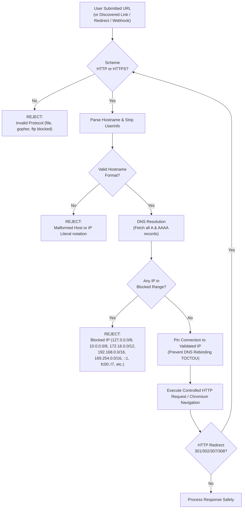

# WebAudit 360 — Security Architecture & Threat Model

**Platform:** WebAudit 360  
**Author:** Harsh Patel  
**Framework:** STRIDE + OWASP ASVS / WSTG  
**Date:** October 30, 2026  
**Document Status:** Approved  

---

## 1. Introduction & Trust Boundaries

WebAudit 360 accepts arbitrary URLs from users and performs automated crawling, browser automation, and security analysis. Because web crawlers and security scanners fundamentally make outbound network requests based on untrusted user input, robust threat modeling is a non-negotiable prerequisite.

### 1.1 System Trust Boundaries
1. **Boundary 0 (External Untrusted):** Public internet, target websites, untrusted user inputs, external DNS resolvers, third-party CDN assets.
2. **Boundary 1 (API Ingress):** Nginx reverse proxy, FastAPI application server, WebSocket gateway. Enforces TLS, rate limiting, authentication, and input schema validation.
3. **Boundary 2 (Internal Management Plane):** PostgreSQL database, Redis message broker, and local/S3 evidence storage. Accessible strictly by API server and isolated workers; never exposed directly to external networks.
4. **Boundary 3 (Scanning & Browser Worker Fleet):** Celery workers executing Playwright Chromium, Lighthouse CLI, HTTPX crawler, and OWASP ZAP. Isolated with strict outbound network policies to prevent internal lateral movement.

---

## 2. Threat Analysis (STRIDE Model)

| STRIDE Category | Threat Description | Potential Impact | WebAudit 360 Mitigation Strategy |
| :--- | :--- | :--- | :--- |
| **Spoofing** | Attacker spoofs identity or claims domain ownership without authorization | Unauthorized active security testing against third-party sites | Strict domain ownership challenge (DNS TXT or `.well-known` token). Cryptographic token verification before enabling active testing. |
| **Tampering** | User tampers with request payloads or modifies finding status of other tenants | Unauthorized status change, data corruption | Server-side validation on every transition. Multi-tenant ownership checks on every database record query (IDOR prevention). |
| **Repudiation** | User denies scheduling an aggressive scan or altering team settings | Auditability failure, accountability disputes | Comprehensive, immutable audit trail (`finding_history`, `activity_logs`) capturing user ID, IP, timestamp, and action. |
| **Information Disclosure** | Server-Side Request Forgery (SSRF) accessing cloud metadata (`169.254.169.254`) or internal databases | Exfiltration of cloud credentials, database dumping | Strict custom IP/DNS validator blocking private/loopback/link-local/cloud ranges. DNS pinning preventing rebinding. Secret redaction in logs/reports. |
| **Denial of Service** | Scans with infinite depth, massive sitemaps, or rapid request bursts overwhelming targets or workers | Worker OOM crashes, target website outages | Hard crawl limits (max 100 pages, max depth 5, per-host concurrency 2, 1-second delay). Worker execution timeouts and memory quotas. |
| **Elevation of Privilege** | Tenant user accesses admin project or viewer promotes themselves to owner | Unauthorized project modification or access | Strict Role-Based Access Control (RBAC) enforced via FastAPI dependency injection at the route level. |

---

## 3. Server-Side Request Forgery (SSRF) Defense Architecture

SSRF is the most critical threat facing web auditing platforms. WebAudit 360 implements a multi-layer defense-in-depth architecture.

### 3.1 Blocked IP Ranges & Hostnames
The SSRF validation module (`app/core/ssrf.py`) validates all candidate IP addresses against RFC standards:
* **IPv4 Loopback:** `127.0.0.0/8`
* **IPv4 Private Networks (RFC 1918):** `10.0.0.0/8`, `172.16.0.0/12`, `192.168.0.0/16`
* **IPv4 Link-Local & Cloud Metadata:** `169.254.0.0/16` (including `169.254.169.254` AWS/GCP/Azure metadata)
* **IPv4 Shared Address Space (RFC 6598):** `100.64.0.0/10`
* **IPv4 Reserved & Multicast:** `0.0.0.0/8`, `224.0.0.0/4`, `240.0.0.0/4`, `255.255.255.255/32`
* **IPv6 Loopback:** `::1`
* **IPv6 Unique Local (RFC 4193):** `fc00::/7`
* **IPv6 Link-Local Unicast (RFC 4291):** `fe80::/10`
* **IPv6 Multicast (RFC 4291):** `ff00::/8`
* **Cloud Metadata Hostnames:** `metadata.google.internal`, `instance-data`, `metadata.internal`

### 3.2 DNS Rebinding Prevention
Attackers can bypass standard validation by configuring a domain whose DNS TTL is 0, returning a valid public IP during validation, and returning `127.0.0.1` when the HTTP client or browser actually connects (Time-of-Check to Time-of-Use).
* **Mitigation:**
  1. For HTTPX crawler requests: A custom transport connects directly to the validated IP address while preserving the original `Host` header.
  2. For Playwright Chromium: Browser sessions run inside isolated network boundaries where routing to RFC 1918 and cloud metadata IPs is blocked at the network interface layer.
  3. Every redirect target is recursively validated before the redirect is followed.

---

## 4. Domain Ownership & Authorization Verification

Active vulnerability scanning (e.g., OWASP ZAP checks) can potentially stress target infrastructure or trigger security alerts. WebAudit 360 enforces strict domain authorization before permitting any active scan.

### 4.1 Verification Workflows
1. **DNS TXT Record Challenge:**
   * WebAudit 360 generates a cryptographically random token: `webaudit360-verification=w360_v1_<hex64>`.
   * Target owner creates a TXT record on their domain: `_webaudit360-challenge.example.com`.
   * WebAudit 360 queries DNS using authoritative nameservers to verify token presence.
2. **Well-Known HTTP File Challenge:**
   * Target owner uploads a token file to: `https://example.com/.well-known/webaudit360-challenge.txt`.
   * WebAudit 360 performs a verified HTTPS GET request to confirm token matching.

### 4.2 Independent Server-Side Enforcement
* **Rule:** Client-side flags (`is_authorized: true`) are never trusted.
* When an active scan job is submitted, the API and background worker independently query the `domain_authorizations` table to verify:
  1. The target domain has an active verification record.
  2. The authorization record is owned by the requesting project/team.
  3. The verification has not expired (authorizations expire every 90 days, requiring renewal).
* If any condition fails, active security tests are immediately rejected with status `BLOCKED: UNAUTHORIZED`. Passive security checks (headers, SSL validity) continue normally.

---

## 5. Authentication, Access Control & API Key Security

* **Passwords:** Hashed using `bcrypt` / `argon2id` with high work factors.
* **Tokens:** Short-lived JWT access tokens (15 minutes) signed with HMAC-SHA256 (`HS256`). Rotating refresh tokens stored with cryptographically secure random IDs in the database.
* **Role-Based Access Control (RBAC):**
  * `Owner`: Full control over project, billing, team memberships, and domain authorizations.
  * `Admin`: Manage audit schedules, run active scans, configure integrations.
  * `Developer`: Trigger audits, retest findings, view evidence, download reports.
  * `Viewer`: Read-only access to audit reports, scores, and findings.
* **Insecure Direct Object Reference (IDOR) Defenses:** Every endpoint that queries a project, audit, finding, or report joins against the current user's organization/project membership.
* **API Keys:** Stored strictly as SHA-256 hashes (`api_key_hash`). The raw key is returned exactly once during creation and can never be retrieved from the database.
* **Webhooks:** Webhook deliveries are signed using HMAC-SHA256 headers (`X-WebAudit360-Signature`). Recipients verify message authenticity and timestamps (5-minute tolerance window to prevent replay attacks). Webhook destination URLs undergo identical SSRF validation.

---

## 6. Secret Redaction & Safe Data Storage

WebAudit 360 inspects websites without compromising sensitive user data:
* **Log Redaction:** A custom logging filter automatically scrubs `Authorization`, `Cookie`, `Set-Cookie`, `apiKey`, `password`, `token`, and `secret` patterns before output.
* **No Plaintext Credential Storage:** External integration secrets (e.g., GitHub OAuth tokens) are encrypted at rest using AES-256-GCM before database insertion.
* **Evidence Scrubbing:** HTTP request/response evidence stored in PostgreSQL `JSONB` automatically strips sensitive session cookies and authorization tokens.

---

## 7. Residual Risks & Operational Safeguards

1. **Denial of Service via Heavy DOMs:** Extremely large or recursive DOM structures can strain headless browser memory. Safeguard: Chromium processes are launched with hard limits (`--js-flags="--max-old-space-size=512"`) and strict per-page execution timeouts (30 seconds).
2. **Third-Party CDN Dynamic Behavior:** Changes in third-party scripts between runs can introduce slight measurement noise. Safeguard: All metrics display confidence intervals and sample size indicators.

